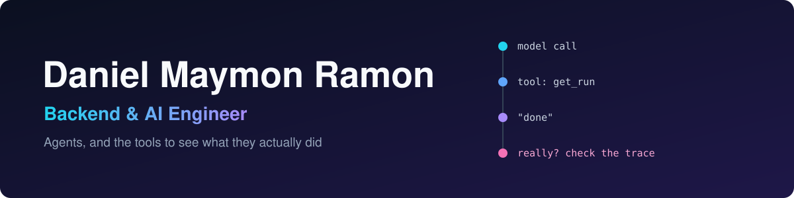

Backend & AI engineer. I build agents, and then I build something that shows me what the agent actually did, because an LLM saying "done" doesn't mean much.

These days most of my time goes into agents running on a self-hosted OpenClaw server (one of them answers baby sleep questions in my family's Telegram group), and tools for reading their traces.

### Agents

- [run-investigation-agent](https://github.com/Daniel1Maymon/run-investigation-agent) - give it a run ID from another agent and it goes through the trace and tells you if the task really got done, and if not, where it broke. Python, FastAPI, OpenRouter.

### Seeing what agents did

- [openclaw-trace-viewer](https://github.com/Daniel1Maymon/openclaw-trace-viewer) - shows the full context that went into every model call in a run, plus the tool calls, failures and cost. It reads the files OpenClaw already writes, so nothing gets installed on the server.
- [claude-live-dashboard](https://github.com/Daniel1Maymon/claude-live-dashboard) - a terminal dashboard for all my running Claude Code sessions. Catches the one that's stuck calling the same tool over and over, or whose context quietly blew up.

### Other stuff

- [writing-assistant](https://github.com/Daniel1Maymon/writing-assistant) - my own Grammarly for macOS, in Swift. Spelling is checked locally with Harper, and an LLM catches sentences that are wrong even when every word is spelled right.
- [dev-dispatch](https://github.com/Daniel1Maymon/dev-dispatch) and [claude-usage-menubar](https://github.com/Daniel1Maymon/claude-usage-menubar) - small tools I use every day with Claude Code.
- [ApartmentHunterBot](https://github.com/Daniel1Maymon/ApartmentHunterBot) - scraped Facebook groups for apartments back when I was looking for one. Still my most starred repo.

Usually working in:

      

 
